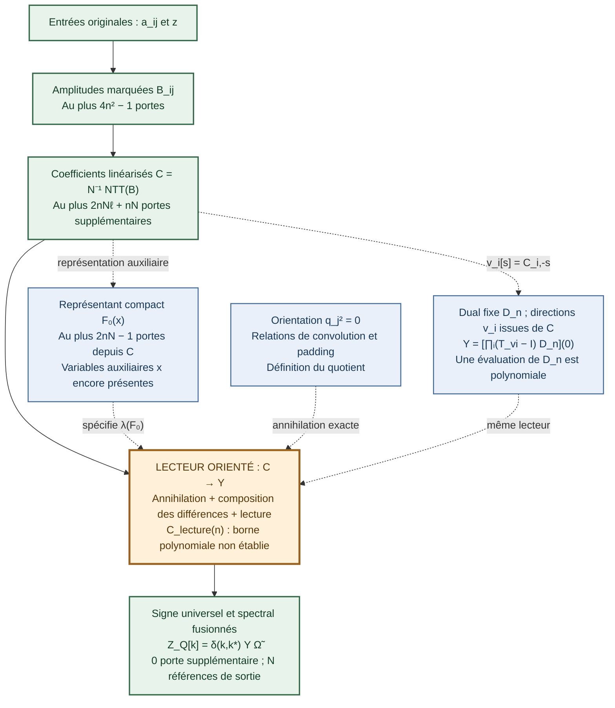

# Architecture du calcul et état précis des coûts

**État du 2 novembre 2026.** La chaîne mathématique est définie et les
raccords indiqués ci-dessous possèdent des preuves algébriques. La
préparation scalaire est polynomiale et effectivement compilée. La
construction générale d'un lecteur scalaire de taille polynomiale reste
à obtenir. Aucun résultat terminal n'est donné comme entrée du calcul.

On compte uniquement les portes scalaires binaires `+` et `×` dans
`F_Q`. Poser `N=2^ell`, `n<=N<2n`. Le premier `Q`, la racine `omega`
d'ordre `N` et les étiquettes `d_j` sont fournis comme paramètres fixes,
avec `Q>max(2,binom(n,2))` et `N | Q−1`. Les coûts affichés sont des
majorants. Les constantes, fils, zéros de padding et réindexations de fils
ne sont pas des portes arithmétiques.

## 1. Schéma de la chaîne après fusion



**Vert :** blocs dont le coût affiché est établi. **Bleu :** représentation
ou identité auxiliaire, avec sa portée propre. **Orange :** un seul bloc
de coût restant à borner polynomialement. Les flèches pointillées ne
désignent pas des étapes supplémentaires à additionner au circuit
principal. La préparation de `F_0` est réellement compilée, mais ses
variables `x` ne sont pas éliminées par cette préparation.

Les définitions exactes sont

\[
B_{ij}=(1+a_{ij}^2)z^{2^{in+j}},\qquad
C_{ir}=\frac1N\sum_{j<n}B_{ij}\omega^{rj},\qquad
F_0(x)=\prod_{i<n}\sum_{r<N}C_{ir}x_{-r}.
\]

L'orientation linéarisée est

\[
x_r=\sum_{j<n}\omega^{rj}q_j,\qquad
q_j^2=0,
\]

avec les relations équivalentes

\[
\frac1N\sum_r x_rx_{t-r}=0,
\qquad
\frac1N\sum_r\omega^{-rj}x_r=0\quad(n\le j<N).
\]

Le dual et les directions sont

\[
D_n(y)=\prod_{j<n}\sum_{s<N}\omega^{sj}y_s,\qquad
v_i[s]=C_{i,-s},\qquad T_vP(y)=P(y+v).
\]

Il en résulte le raccord exact, où `lambda` désigne le coefficient de
`q_0...q_(n-1)` dans le quotient :

\[
Y=\lambda(F_0)
 =\left[F_0(\partial_y)D_n\right](0)
 =\left[\prod_{i<n}(T_{v_i}-I)D_n\right](0),
\qquad
\mathcal Z_Q[k]=\delta_{k,k_*}Y\widetilde\Omega,
\quad k_* = \sum_jd_j\bmod N.
\]

## 2. Inventaire des coûts établis

Les postes de la première partie du tableau sont les étapes successives
de la préparation. Les postes locaux du lecteur servent à apprécier sa
composition ; ils ne sont pas tous ajoutés au total.

| Élément | Majorant de portes | Ce qui est établi |
|---|---:|---|
| Entrées `a,z` | `0` | `n²+1` fils |
| Marques `z^(2^k)` | `n²−1` | Carrés successifs, exposants formels conservés |
| Tous les `1+a_ij²` | `2n²` | Un carré et une addition par entrée |
| Produits donnant `B_ij` | `n²` | Préparation totale `4n²−1` |
| NTT des `n` lignes | `2nN ell` | Quatre portes par papillon ; code radix deux |
| Normalisation par `1/N` | `nN` | Constante fournie |
| Représentant `F_0` depuis `C` | `2nN−1` | Circuit ordinaire en variables auxiliaires |
| Une évaluation de `D_n` | `E_D<=2N ell+n−1` | Une NTT et un produit de `n` sorties |
| Calcul de tous les polynômes de relations, padding inclus | `4N ell+2N` | INTT, carrés, NTT ; ce n'est pas la réduction de `F_0` |
| Translation d'un circuit courant de `S` portes | `S+N` | Les coordonnées du déplacement sont déjà disponibles |
| Une différence appliquée à ce circuit | `2S+N+2` | Deux évaluations et une soustraction |
| Fusion des paramètres de `m` translations seules | `(m−1)N` | Loi exacte `T_u T_v=T_(u+v)` |
| Une différence réelle sur `D_n`, en zéro | `n−1` depuis `B` | Elle vaut `prod_j B_ij` |
| Correction universelle du signe | `0` après normalisation, sinon au plus `1` | Convention `gamma_n q_top=Omega_tilde` |
| Phases et INTT finales | `0` après fusion | Routage de `Y` vers l'indice fixe `k_*` |

La normalisation du signe et le routage conservent `N` références de
sortie. Le coût nul concerne les portes arithmétiques supplémentaires.

Le sous-total des coefficients et celui du représentant sont distincts :

\[
C_{\mathrm{coeff}}\le4n^2-1+2nN\ell+nN,
\]
\[
C_{F_0}\le4n^2-2+2nN\ell+3nN=O(n^2\log(n+1)).
\]

## 3. Ce que les vérifications certifient exactement

| Résultat | Preuve ou contrôle disponible | Limite de cette validation |
|---|---|---|
| Changement de base, convolution, lecteur dual, fusion spectrale | Démonstrations algébriques dans les notes et contrôles exacts finis | La taille scalaire générale du lecteur n'en découle pas |
| Majorant de la préparation `C_F0` | Décompte des portes de la construction et compte du graphe réellement produit | Il porte sur un représentant auxiliaire |
| Inégalité `4n²−2+2nN ell+3nN<=18n³` | Certificat Lean sous `n>=1`, `N<=2n`, `ell<=n` | Lean ne formalise ici ni le décompte du programme ni le lecteur |
| Raccord de la préparation fusionnée | 24 tables numériques pour `n=1..8`, modulo `97` | Contrôles de petites tailles |
| Conservation du marquage formel | 4 tables avec `z` formel, `n=1..4` | Pas de réduction des exposants modulo `Q−1` |
| Raccord aux différences | 24 contrôles de la lecture terminale | L'évaluateur de référence utilise des développements externes au circuit préparé |

Les comptes réellement atteignables dans le graphe préparé sont :

| n | Coefficients seuls | Représentant `F_0` | Chaîne scalaire complète polynomiale certifiée ? |
|---:|---:|---:|---|
| 6 | 401 | 496 | Non |
| 7 | 517 | 628 | Non |
| 8 | 647 | 774 | Non |

Les 496, 628 et 774 portes ne sont donc pas des tailles de la chaîne
complète calculant `Y`. Les drapeaux du rapport l'indiquent explicitement :
`complete_scalar_Z_compiled=false` et
`general_polynomial_quotient_reader_established=false`.

## 4. Le coût connu mais insuffisant, et le coût encore non maîtrisé

La loi de fusion des translations est prouvée. Elle donne, pour les
différences `Delta_v=T_v-I`,

\[
\Delta_u\Delta_v
 =\Delta_{u+v}-\Delta_u-\Delta_v.
\]

Cette identité conserve plusieurs termes. En appliquant la construction
locale par duplication à un circuit courant, on obtient un majorant
général valide

\[
S_{r+1}\le2S_r+N+2,\qquad
S_m\le2^m E_D+(2^m-1)(N+2).
\]

Cette borne explique le coût de la réalisation par duplication.
Elle ne constitue pas une borne inférieure sur toutes les réalisations.
La présence de `n` différences dans une écriture compacte ne démontre
pas que leur application à `D_n` coûte `n` fois l'évaluation initiale :
à l'étape suivante, l'opérande est le circuit transformé, de taille `S_r`.

**L'inventaire doit aussi conserver le compilateur générique polynomial
déjà prouvé dans Lean, n57–n59.** Pour une représentation `uᵀM^K v`
de dimension `r`, construite en `S` portes, il fournit
`S+J(K)(2r³−r²)+2r²+r−1` portes, avec `J(K)<=2 log2 K` pour `K>=1`.
La lecture terminale et le partage sont compris. Avec `K=n^n−1`,
`r<=n^d` et `S<=n^c`, la borne certifiée devient
`n^c+4n^(3d+2)+3n^(2d)` (`r>=1`, `n>=2`).
Le transport rationnel et les compilateurs de dérivation possèdent
également des bornes polynomiales sur leurs interfaces respectives.
L'[audit ciblé](AUDIT_COMPILATION_GENERIQUE_2026-11-02.md) rétablit
ces résultats : la duplication n'est pas notre seul outil disponible.

**Le coût non maîtrisé est celui d'une réalisation plus compacte de la
composition complète et de sa lecture, depuis les données préparées.**
La difficulté est une propriété de la composition, même si chaque
opérateur individuel possède une règle de calcul exacte.

Pour une stratégie utilisant une famille de représentations fermée par
fusion, la démonstration restante devrait fournir :

1. Une représentation des intermédiaires effectivement initialisée depuis
   `C`, avec une taille bornée polynomialement en `n` à tout ordre requis.
2. Des mises à jour ou fusions exprimées en portes scalaires, dont les
   partages et le coût total sont eux aussi bornés polynomialement.
3. Une lecture terminale qui élimine les auxiliaires et produit `Y`, sans
   extraction de coefficient ni action d'opérateur comptée gratuitement.

Ce sont les obligations de cette stratégie constructive. Elles ne
prétendent pas imposer une représentation particulière à tous les
circuits possibles. La recherche peut fusionner davantage la préparation
et la lecture pour exploiter leurs fils communs.

## 5. La démonstration générale qu'il reste à fermer

Définir `C_lecture(n)` comme le nombre de portes supplémentaires d'une
réalisation scalaire du lecteur à partir des fils `C`. Le raccord des
coûts donne

\[
\boxed{
C_{\mathrm{chaîne}}(n)
\le4n^2-1+2nN\ell+nN+C_{\mathrm{lecture}}(n).
}
\]

Le travail d'annihilation, de composition et de lecture est compté une
seule fois dans `C_lecture`. Les branches auxiliaires du schéma ne sont
pas ajoutées une seconde fois.

Si une construction vérifiée établit, pour des constantes indépendantes
de `n`, `C_lecture(n)<=K n^c`, avec `K,c` naturels, on aura immédiatement

\[
\boxed{C_{\mathrm{chaîne}}(n)
 \le(K+18)n^{\max(3,c)}\qquad(n\ge1).}
\]

Cette implication est établie par le raccord du coût. L'hypothèse sur
`C_lecture` reste à démontrer. Le certificat Lean actuel ne la suppose
pas implicitement et ne conclut pas à la polynomialité de toute la chaîne.

Les coûts binaires des opérations de corps, la recherche de `Q,omega`
et un éventuel relèvement depuis le modulo `Q` constituent d'autres
questions, hors du modèle de portes fixé pour cet inventaire.

## Sources et reproduction

- [Inventaire détaillé, avec les variantes historiques](INVENTAIRE_COUTS_2026-11-02.md)
- [Forme linéarisée et quotient orienté](../etudes/2026-11-01/linearisation-orientee-convolution/FORME_LINEARISEE.md)
- [Démonstration du raccord fusionné](../etudes/2026-11-01/linearisation-orientee-convolution/FUSION_LINEARISEE.md)
- [Compilateur de préparation](../etudes/2026-11-01/linearisation-orientee-convolution/fused_linearised.py)
- [Rapport des contrôles exacts](../etudes/2026-11-01/linearisation-orientee-convolution/fused-linearised-validation.json)
- [Rapport Lean et portée du certificat](../etudes/2026-11-01/linearisation-orientee-convolution/lean/preparation-bound-lean-validation.json)

Commandes de reproduction des rapports conservés :

```text
python outils/reproduire.py run fusion-matrice-linearisee
python outils/reproduire.py run preuve-preparation-linearisee
```
