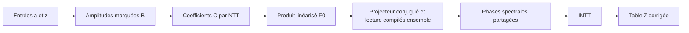

# Variante différentielle linéarisée : construction et taille du prototype

3 novembre 2026. **Périmètre corrigé après contestation du décompte.**

Cette note mesure un prototype qui développe des dérivées de représentants
ordinaires. Elle ne fournit pas le coût de l'architecture orientée native
recherchée. Les h filtres sont redondants dans le quotient : rho L=0, donc
rho pi_h(L)=rho. Leur implémentation différentielle et ses familles de
dérivées ne sont pas imposées à la compilation conjointe.
Voir la [correction et sa preuve](CORRECTION_PERIMETRE_BORNE_2026-11-03.md).
Les majorants ci-dessous restent des résultats sur cette variante explicite,
et sont retirés comme réponse à la borne polynomiale générale demandée.

La borne polynomiale générale depuis `a,z` n'est pas établie. En revanche,
la borne polynomiale des **h compositions sur l'état fermé** avait bien été
démontrée. Cette reprise rétablit ce résultat, raccorde effectivement le
compilateur à la forme linéarisée et améliore le majorant général du DAG.
Elle ne remplace pas les entrées originales par une amplitude ou par des
observations fournies gratuitement.

## 1. Modèle et chaîne conservée

On compte les portes scalaires binaires `+` et `*`, y compris les produits
par constantes et les soustractions réalisées par multiplication par `-1`.
Les sorties peuvent partager tous leurs fils. Les paramètres fournis sont
un premier `Q>max(2,h)`, une puissance de deux `N`, une racine `omega`
d'ordre exact `N`, et des labels `d_j`, avec `N | Q-1`.
On choisit ici `n<N<=2n`, comme le compilateur historique, et
`h=n(n-1)/2`. Les exposants de `z` restent formels.

Le bloc central élimine les variables auxiliaires du représentant. La
correction universelle est déjà comprise dans
`gamma_n q_[n] = Omega_tilde`. Le schéma n'ajoute donc aucun second signe.

Les formules de préparation sont
\[
B_{ij}=(1+a_{ij}^2)z^{2^{in+j}},\qquad
C_{ir}=\frac1N\sum_{j<n}B_{ij}\omega^{rj},\qquad
F_{0,n}(x)=\prod_{i<n}\sum_{r<N}C_{ir}x_{-r}.
\]
Leurs coûts, avec partage de la préparation des marqueurs, sont
\[
C_B\le4n^2-1,
\qquad
C_C\le4n^2-1+2nN\ell+nN\le10n^3,
\quad \ell=\log_2N\le n,
\]
\[
P:=C_{F_0}\le4n^2-2+2nN\ell+3nN\le18n^3.
\]
`P` inclut déjà `B` et `C`. Il ne faut pas additionner ces trois majorants.
Les paramètres de corps, leurs inverses structurels et leur recherche ne
sont pas des données variables du circuit ; la génération de paramètres
admissibles n'est pas revendiquée ici.

## 2. Raccord constructif du projecteur dans les coordonnées linéarisées

Définir, sur les polynômes ordinaires en `x`,
\[
q_j(x)=\frac1N\sum_{r<N}\omega^{-rj}x_r,
\qquad
\delta_j=\sum_{r<N}\omega^{rj}\partial_{x_r},
\qquad
\mathscr L=\frac12\sum_{j<n}q_j(x)^2\delta_j^2.
\]
L'orthogonalité Fourier donne `delta_j q_k = 1` si `j=k`, et zéro sinon.
Avec
\[
\Xi(s)_r=\sum_{j<n}\omega^{rj}s_j,
\]
on a, pour les orientations actives,
\[
q_j(\Xi(s))=s_j,\quad
F_{0,n}(\Xi(s))=G_B(s),\quad
(\mathscr L F)(\Xi(s))=L(F\circ\Xi)(s),
\quad L=\frac12\sum_{j<n}s_j^2\partial_{s_j}^2.
\]
Les coordonnées `q_j` avec `j>=n` s'annulent sur cette substitution : le
padding est conservé. Le dernier entrelacement suit de la règle de chaîne.

Le compilateur construit donc directement
\[
H_0^x=F_{0,n},\qquad
H_r^x=(I-\mathscr L/r)H_{r-1}^x\quad(1\le r\le h),
\qquad Y=H_h^x(\Xi(\mathbf1)).
\]
Le projecteur de collisions donne exactement
\[
Y=\lambda(F_{0,n}),\qquad
S[f]=\omega^{f\sum_jd_j}Y,\qquad
\mathcal Z_Q[k]=\widetilde\Omega\,\operatorname{INTT}_N(S)[k].
\]
`Y` est un fil construit à l'intérieur du circuit, jamais une entrée.
La modulation est déplacée après le projecteur par l'identité de phase
commune déjà démontrée, et non appliquée séparément aux moments non filtrés.

Le programme
[linearised_full_chain.py](borne-partagee-2026-11-03/linearised_full_chain.py)
réalise ces opérations. La dérivation directionnelle d'une feuille `x_r`
renvoie la constante `omega^(rj)` ; les autres nœuds utilisent exactement
les règles de dérivation du DAG historique. Aucune dérivée ne subsiste
comme porte d'exécution. Une vraie INTT radix deux est exécutée dans le
circuit compilé. Une sortie équivalente par routage est aussi construite,
pour contrôler la fusion complète du spectral.

## 3. La borne polynomiale après h compositions déjà acquise

Dans l'espace homogène de degré `n`, poser
\[
\chi(X)=\prod_{r=0}^{h}(X-r)
=X^{h+1}+\sum_{j=0}^h c_jX^j.
\]
Sur un monôme `s^alpha`, la valeur propre de `L` est
`kappa(alpha)=sum_j binom(alpha_j,2)`, entre `0` et `h`.
Ainsi `chi(L)=0`, et la même relation vaut pour la représentation
linéarisée conjuguée sur les formes considérées. Ce n'est pas une
nilpotence de `L`.

Pour un état déjà construit `m_j=(L^jH)(t)`, `0<=j<=h`, le facteur
`I-L/r` se compile exactement par
\[
m'_j=m_j-\frac1r m_{j+1}\quad(j<h),\qquad
m'_h=m_h+\frac1r\sum_{j=0}^{h}c_jm_j.
\]
La dernière formule remplace `m_(h+1)` par `-sum c_j m_j`.
Chaque mise à jour utilise les fils de l'ancien état, sans en redériver
les circuits. Les `h` premières sorties coûtent `2h` portes ; la dernière
au plus `2h+2`. Par conséquent
\[
\boxed{C_{h\text{ compositions}}\le4h^2+2h=O(n^4).}
\]
Ce résultat était établi dans
[ORBITE_ET_FERMETURE.md, section 3](../etudes/2026-11-01/orbite-scalaire/ORBITE_ET_FERMETURE.md)
et son composant `collision_observer.py`.

La fusion de ces facteurs avec la lecture est plus courte. Avec
\[
\pi_n(X)=\prod_{r=1}^h(1-X/r)=1+\sum_{j=1}^h p_jX^j,
\qquad \mu_j=(L^jG_B)(\mathbf1),
\]
elle devient `mu_0 + sum_(j=1)^h p_j mu_j`, soit **2h portes**.
Si l'on compte la construction des coefficients structurels `p_j`, les
produits successifs de facteurs linéaires coûtent au plus
`sum_(r=1)^h (2r-1)=h^2` opérations de corps, inverses légaux fournis.
Ces bornes portent sur tout le lecteur composé, et pas seulement un facteur.

## 4. Le coût total sans double comptage

Noter `I_mu^C(n,N)` le coût de construction simultanée des observations
à partir des fils `C_ir`, incluant toute la compilation qui élimine les
auxiliaires. Cette notation est une mesure de coût, pas une hypothèse de
polynomialité. La réalisation par l'état fermé donne
\[
\boxed{C_{\rm total}\le C_C+I_\mu^C+h^2+2h.}
\]
La fusion spectrale utilise l'orthogonalité des caractères :
\[
\operatorname{INTT}_N[(\omega^{fD}Y)_f][k]
=\delta_{k,D\bmod N}Y,\qquad D=\sum_jd_j.
\]
Elle supprime le surcoût arithmétique terminal par routage ; les `N`
références de sortie restent présentes. Si l'on garde explicitement les
phases et l'INTT, ajouter au plus `2N ell+2N<=8n^2` portes.

La même architecture peut fusionner la construction des observations et
leur contraction sans matérialiser l'état. Pour un lecteur complet de
coût `R(n,N)` à partir de `C`, on a directement
\[
C_{\rm total}\le C_C+R(n,N)\le10n^3+R(n,N).
\]
Ces deux interfaces sont des réalisations possibles, pas des étapes
obligatoires qui s'ajouteraient l'une à l'autre. Le coût `I_mu` ou `R`
ne peut pas être remplacé par le nombre de leurs sorties.

Les constantes antérieures `c=5,d=2` décrivent le générateur conservant
ses variables auxiliaires ; `d=2` décrit aussi la dimension du lecteur
sur observations. Elles ne fournissent pas une borne sur la génération
des observations de ce lecteur. Le compilateur matriciel générique
conserve explicitement son hypothèse de coût initial polynomial.

## 5. Nouvelle borne générale constructive du graphe partagé

Le décompte local, valable aussi pour les dérivées directionnelles, donne
\[
S_0\le P+2nN,\qquad S_{r+1}\le(9n+1)S_r+3n+2.
\]
`S_r` compte conjointement la racine et les coordonnées inverses `q_j`.
L'ajout `2nN` construit ces coordonnées une seule fois. Il suffit de
neuf portes par porte existante pour ses première et seconde dérivées
dans une direction ; les autres opérations de `L` et de la mise à jour
ajoutent au plus `3n+2` portes.

On peut améliorer la majoration en comptant globalement les portes créées
hors dérivation, puis leurs familles de dérivées partagées. Pour `n>=2`,
poser
\[
B_* = P+2nN+h(3n+2),\qquad
A_n=\sum_{k=0}^n n^k(2^{k+1}-1).
\]
Chaque porte source est syntaxiquement homogène de degré au plus `n` dans
les auxiliaires. Une famille issue d'une porte binaire et d'un mot de `k`
dérivations a au plus `2^{k+1}-1` positions propres au gabarit de Leibniz.
Les dérivées des opérandes sont des fils partagés comptés à leur propre
provenance. Dériver un nœud intermédiaire prolonge un tel mot ; cela ne
crée pas une nouvelle source indépendante. Les mots utiles ont longueur
au plus `n` et il y a `n^k` mots de longueur `k`.

La [preuve détaillée](borne-partagee-2026-11-03/BORNE_AFFINEE.md)
établit ce comptage pour le DAG historique. Il s'applique aussi au code
linéarisé : ses dérivations directionnelles abaissent le degré homogène
d'une unité, leurs valeurs sur les feuilles sont des constantes et elles
utilisent les mêmes règles de somme, produit, cache et internement.
Le seul changement est le nombre initial de portes sources `P+2nN`.

Ainsi, pour cette réalisation complète avec phases partagées et vraie INTT,
\[
\boxed{
C_{\rm lin,INTT}(n,N)
\le B_*A_n+2N\ell+2N
\le4B_*(2n)^n+8n^2.
}
\]
Avec `N<=2n`, `ell<=n`, `h<=n^2` et `P<=18n^3`,
`B_*<=27n^3`. Une borne entièrement explicite est donc
\[
\boxed{C_{\rm lin,INTT}(n)\le108n^3(2n)^n+8n^2\qquad(n\ge2).}
\]
Le cas `n=1` est direct. La borne est
`2^{O(n log(n+1))}`, améliorant le majorant itéré
`2^{O(n^2 log(n+1))}`. **Elle n'est pas un majorant polynomial.**
Les mots de dérivation servent à la preuve de comptage ; aucun tableau
de jets ou de sous-ensembles n'est introduit dans le compilateur.

## 6. Pourquoi le compilateur historique ne suffit pas à conclure

La [preuve de croissance de la chaîne historique complète](borne-partagee-2026-11-03/CROISSANCE_COMPILATEUR_COMPLET.md)
prolonge l'ancien comptage du préfixe jusqu'aux phases et à la vraie INTT.
Pour ce programme précis et ses règles de partage syntaxique,
\[
C_{\rm historique}(2m)\ge\binom{2m}{m}\ge2^m\quad(m\ge2).
\]
Les racines de dérivées témoins restent accessibles bien que certains
termes se compensent dans le polynôme calculé. Le test retrouve ces
racines dans le circuit déjà construit, sans allouer de nouveaux nœuds.
Ce minorant n'est pas transféré au nouveau compilateur linéarisé ni à
tous les circuits possibles de la chaîne.

## 7. Vérifications et portée

- [Vérification de la chaîne linéarisée](borne-partagee-2026-11-03/linearised-full-chain-validation.json) : coordonnées inverses, dérivées directionnelles, étapes du projecteur, lecture, phases, vraie INTT, routage et entrées finales. Les énumérations de petites tailles se trouvent uniquement dans le vérificateur.
- [Vérification de conservation des témoins](borne-partagee-2026-11-03/full-chain-validation.json) : compilateur historique intact, `n=4,6`, toutes les compositions et sorties spectrales.
- [SharedChainBounds.lean](borne-partagee-2026-11-03/SharedChainBounds.lean) : conséquences arithmétiques des coûts et hypothèses explicités. La preuve de provenance des portes, la correction du compilateur Python et la borne sur l'initialisation des observations ne sont pas formalisées par ce certificat.

La reprise fournit une construction complète dans les coordonnées
linéarisées, un majorant général amélioré et la restitution de la vraie
borne polynomiale aval. Elle ne fournit pas la démonstration demandée
`C_total(n)<=K n^c` depuis les entrées originales.
